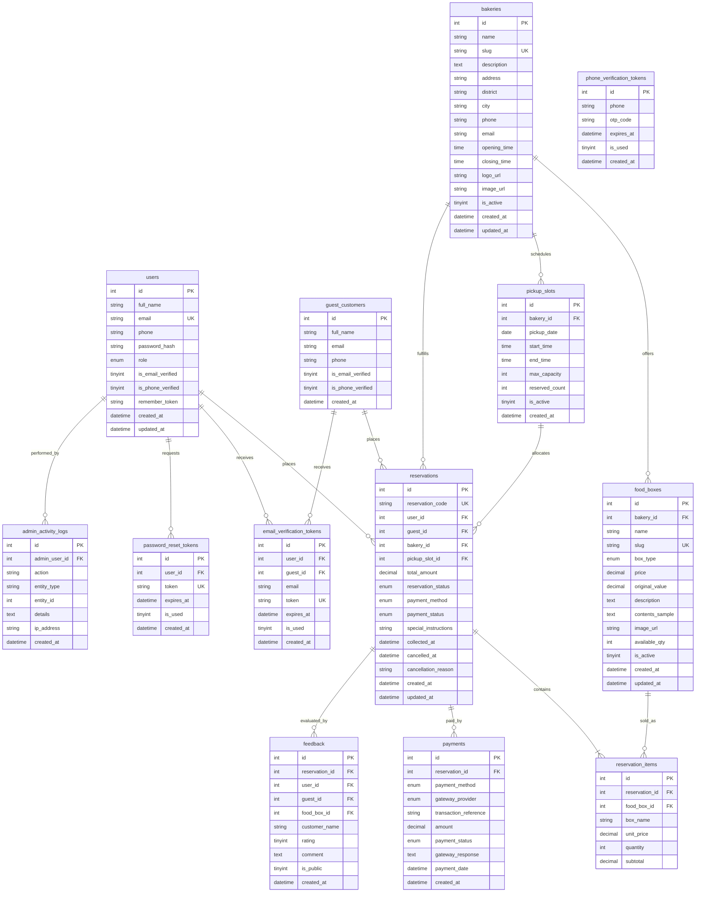

# NomReNom – Database Architecture & Entity Relationship Diagram (ERD)

This document describes the schema design, table structures, and entity relationships of the `nomrenom_db` MySQL database for the **NomReNom** surplus-food marketplace.

---

## 1. Entity Relationship Diagram (ERD)

---

## 2. Table Descriptions & Business Rules

### `users`
Stores registered customer accounts and administrator users.
- `role`: Distinct role separation (`customer` vs `admin`).
- `password_hash`: Uses PHP's `password_hash()` with `PASSWORD_DEFAULT` (Bcrypt/Argon2i). Never plain text.
- `is_email_verified`: Flags whether customer clicked their activation link.

### `guest_customers`
Enables guests to reserve food without an account.
- Captures verified email and phone number for pickup notifications.
- Referenced by `reservations.guest_id`.

### `bakeries`
Stores partner bakeries in Vietnam with their operating hours, contact details, and locations.
- `district` & `city`: Facilitates neighborhood search for university campuses.

### `food_boxes`
The core surplus offerings.
- `box_type`: Either `snack_box` (40,000 VND) or `meal_box` (70,000 VND).
- `original_value`: Stored to calculate and display consumer savings.
- `available_qty`: Live stock counter guarded by atomic DB transactions (`SELECT ... FOR UPDATE`).

### `pickup_slots`
Daily collection windows per bakery (e.g. 17:30 - 18:30, 19:00 - 20:30).
- `max_capacity` & `reserved_count`: Prevents store congestion during collection.

### `reservations`
Order transactions.
- `reservation_code`: Unique reference (e.g. `NRN-20261105-ABCD`) used for pickup identification and guest lookup.
- `reservation_status`: `Pending`, `Confirmed`, `Collected`, `Cancelled`.
- `payment_status`: Decoupled from reservation status (`Pending`, `Paid`, `Failed`, `Refunded`, `Pay at Pickup`).

### `payments`
Tracks financial transactions.
- Integrates with VNPay and MoMo gateways via transaction references and cryptographic hash verification.
- Supports in-person "Pay at Pickup".

### Security & Token Tables
- `email_verification_tokens`: Time-expiring cryptographic tokens for account activation.
- `phone_verification_tokens`: OTP codes for phone number confirmation.
- `password_reset_tokens`: One-time password reset tokens.
- `admin_activity_logs`: Immutable audit trail of administrative modifications.
